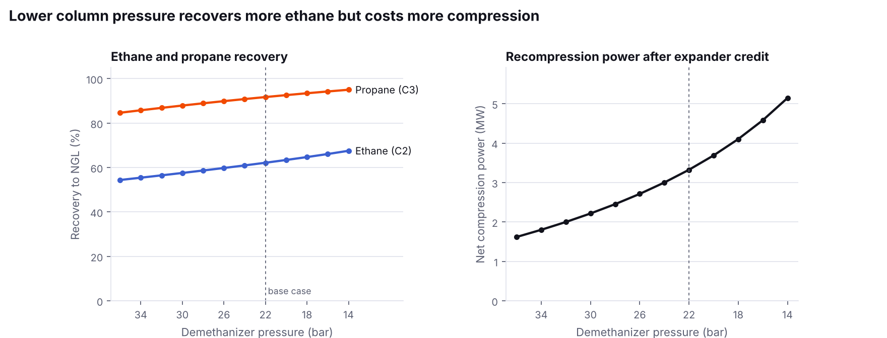
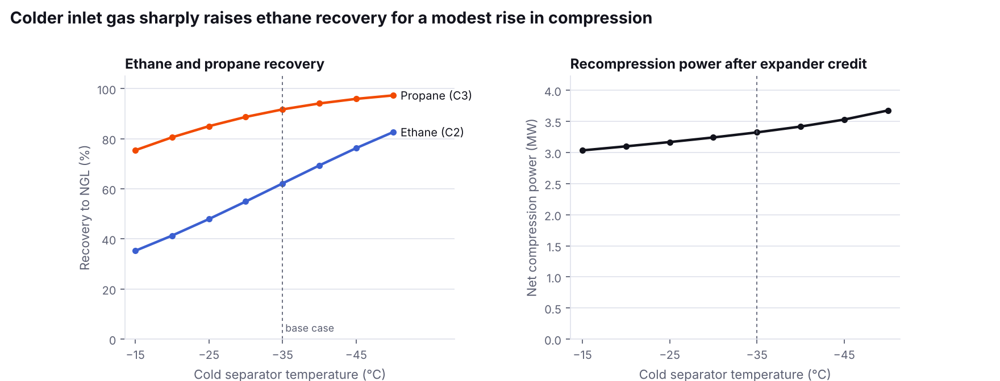

# Turbo Expander NGL Recovery Simulator

A Python simulation of a generic natural gas liquids (NGL) recovery plant, with an interactive Streamlit app and sensitivity studies.

I built this to show how a cryogenic gas plant works and how operating choices trade product recovery against energy use. The idea comes from my experience as part of the team commissioning a gas conditioning plant. The model uses **generic, public-style feed data** and does not represent any real plant.

## The problem

Natural gas contains valuable heavier hydrocarbons (ethane, propane, butanes and heavier) that are worth more as liquids than as fuel gas. A turbo expander plant chills the gas so these components condense, then separates them in a demethanizer column. The key operating question is **how cold and how low in pressure to run**: colder and lower pressure recovers more liquid, but costs more refrigeration and recompression power.

## Flowsheet

```
Feed gas (sweet, dry, 65 bar, 30 °C)
  -> inlet cooling (gas/gas exchanger + chiller)
  -> cold separator
       vapour -> turbo expander ----> demethanizer top stage -> residue gas -> booster + residue compressor -> sales (65 bar)
       liquid -> JT valve ----------> demethanizer           -> NGL product (ethane plus)
```

## How it works

| Unit | Model |
|---|---|
| Thermodynamics | Peng-Robinson equation of state with ChemSep binary interaction parameters (`thermo` library) |
| Cold separator | Isothermal flash after inlet cooling, 0.5 bar pressure drop |
| Turbo expander | Isentropic expansion corrected by efficiency (82% base case); power credited to the booster compressor |
| JT valve | Isenthalpic flash |
| Demethanizer | Simplified: cold top stage (adiabatic mix of expander and JT outlets) plus an ideal stripping section that meets a methane-to-ethane ratio of 0.02 in the NGL. Reboiler duty from an energy balance |
| Recompression | Residue gas warmed to 25 °C, compressed back to 65 bar at 78% isentropic efficiency |

## Base case results (100 MMscf/d, cold separator −35 °C, demethanizer 22 bar)

| Result | Value |
|---|---|
| Ethane recovery | 62.2 % |
| Propane recovery | 91.7 % |
| Butanes and heavier | over 98 % |
| NGL product | 707 t/d |
| Expander outlet temperature | −79 °C |
| Net compression power (after expander credit) | 3.32 MW |

These match the typical range for a conventional single-expander process.

## What the sensitivity studies show



Lowering the demethanizer pressure from 36 to 14 bar raises ethane recovery from 54% to 68%, but the net compression power more than triples (1.6 to 5.1 MW).



Cooling the cold separator from −15 °C to −50 °C raises ethane recovery from 35% to 83%, while net compression rises only about 20% (3.0 to 3.7 MW). The cost moves to inlet refrigeration instead.

## Limits

This is an educational model built to show trends and trade-offs. It does not include a rigorous tray-by-tray column, reflux or side reboilers (which is why ethane recovery is lower than in modern GSP-type designs), hydrate or CO2 freezing checks, or pressure drops through exchangers. A design would use a rigorous simulator such as Aspen HYSYS.

## Run it

```bash
pip install -r requirements.txt
streamlit run app.py            # interactive app
python sensitivity.py           # regenerate the charts and CSVs in results/
python ngl_plant.py             # print the base case
```

## Tools

Python, thermo (Peng-Robinson EOS), NumPy, pandas, Matplotlib, Streamlit, Altair.

---
Built by Philipa Opoku · [Portfolio](https://philipaopoku-ds.github.io/My_Portfolio_WEBSITE/) · [LinkedIn](https://www.linkedin.com/in/philipa-opoku)
